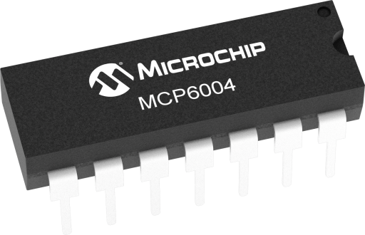
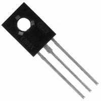
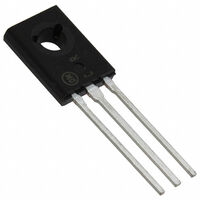
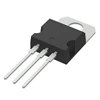

*Table 1: DAC component selection*

**Digital-to-Analog Converter (DAC) — Individual Subsystem**

| **Solution** | **Pros** | **Cons** |
|---|---|---|
|  **Option 1.** PIC18F57Q43 Internal 8-bit DAC $0 additional cost [PIC18F57Q43 Datasheet](https://www.microchip.com/en-us/product/PIC18F57Q43) | * No additional IC required * No additional PCB space required * No additional cost * No SPI communication required * 8-bit output is sufficient for basic tones and speech | * Limited to 256 output levels * Lower audio resolution than external DAC options * Uses an internal PIC peripheral |
|  **Option 2.** Microchip MCP4911-E/MS 10-bit SPI DAC $1.83/each [DigiKey Product Page](https://www.digikey.com/en/products/detail/microchip-technology/MCP4911-E-MS/2332825) | * 1024 output levels * Four times as many output levels as an 8-bit DAC * 2.7–5.5 V supply is compatible with the 5 V system * Simple SPI interface * Buffered voltage output * Good balance between resolution and cost | * Requires an additional IC * Requires additional PCB space * Requires SPI connections to the PIC * Requires an external voltage reference |
|  **Option 3.** Microchip MCP4921-E/SN 12-bit SPI DAC $2.62/each [DigiKey Product Page](https://www.digikey.com/en/products/detail/microchip-technology/MCP4921-E-SN/716196) | * 4096 output levels * Highest resolution of the three options * 2.7–5.5 V supply is compatible with the 5 V system * Simple SPI interface * SOIC package is relatively easy to solder | * Highest cost of the three options * Requires an additional IC and PCB space * Requires SPI connections to the PIC * 12-bit resolution may be unnecessary for speech, tones, and alerts * Requires an external voltage reference |

**Choice:** Option 2: Microchip MCP4911-E/MS 10-bit DAC

**Rationale:** The MCP4911 was selected because its 10-bit resolution provides 1024 discrete output levels, compared with only 256 levels from the PIC's internal 8-bit DAC. This provides improved resolution for recorded speech and audio while maintaining a simple SPI interface and compatibility with the board's 5 V power system. The MCP4921 provides greater 12-bit resolution, but this additional resolution is not necessary for the intended speech, tone, and alert playback application. The MCP4911 therefore provides a balance between audio resolution, cost, and PCB design complexity.
 

Both the MCP4911 and the PIC's onboard DAC are included in the final design to provide redundancy during testing. A solderable jumper allows either DAC to be connected to the amplifier input. The MCP4911 is intended to be the primary audio source, while the onboard DAC provides a fallback if problems occur with the external DAC or SPI communication.

 
 

*Table 2: Operational amplifier component selection*

**Operational Amplifier — Individual Speaker Subsystem**

| **Solution** | **Pros** | **Cons** |
|---|---|---|
|  **Option 1.** Microchip MCP6004 Quad General-Purpose Operational Amplifier [Microchip MCP6004 Product Page](https://www.microchip.com/en-us/product/MCP6004) | * Operates from 1.8 V to 6 V, making it compatible with the board's 5 V supply * Rail-to-rail input and output operation * Four op-amps are included in a single IC * 1 MHz gain-bandwidth product is sufficient for the intended speech and tone frequencies * Low typical quiescent current of approximately 100 µA per amplifier * Available in through-hole PDIP as well as SOIC and TSSOP packages * Already used in previous course/lab circuits, reducing implementation and debugging risk | * 1 MHz bandwidth is lower than higher-performance alternatives * 0.6 V/µs slew rate limits high-frequency/high-amplitude performance * The op-amp cannot directly drive the 4 Ω speaker and requires an external transistor power stage * Four amplifiers are included even though only one is required for the primary audio signal path |
|  **Option 2.** Texas Instruments LMV324A Quad Low-Voltage Operational Amplifier [Texas Instruments LMV324A Product Information](https://www.ti.com/product/LMV324A) | * Designed for low-voltage operation from 2.5 V to 5.5 V * Compatible with the board's 5 V supply * Four amplifiers in one IC * 1 MHz unity-gain bandwidth * Rail-to-rail output * Approximately 1.7 V/µs slew rate, faster than the MCP6004 * Low quiescent current | * Input is not fully rail-to-rail across the entire supply range * Does not eliminate the need for the external BD139/BD140 speaker power stage * Provides little practical bandwidth advantage for the intended speech and alert application * Less familiar than the MCP6004 for this project |
|  **Option 3.** Texas Instruments TLV9004 Quad Rail-to-Rail Operational Amplifier [Texas Instruments TLV9004 Product Information](https://www.ti.com/product/TLV9004) | * Operates from 1.8 V to 5.5 V * Rail-to-rail input and output operation * Four amplifiers in one package * 1 MHz gain-bandwidth product * Approximately 2 V/µs slew rate provides better large-signal performance than the MCP6004 * Very low input bias current * Low quiescent current * Good specifications for single-supply analog signal conditioning | * Higher performance is not necessary for the intended speech, tones, and alert signals * Still requires an external transistor output stage to drive the 4 Ω speaker * Less familiar than the MCP6004, potentially increasing implementation/debugging time * Offers limited practical improvement for this particular circuit despite its better slew rate |

**Choice:** Option 1: Microchip MCP6004

**Rationale:** The MCP6004 was selected because it provides the necessary performance for the custom speaker amplifier while remaining compatible with the board's 5 V supply. Its rail-to-rail input and output operation allows the audio circuit to operate around the 2.5 V reference used by the single-supply amplifier, while its 1 MHz gain-bandwidth product is sufficient for the intended speech, warning tones, and other audio signals. Although the LMV324A and TLV9004 provide improved slew-rate performance, this additional performance is not necessary for the intended audio bandwidth. The MCP6004 has also been used in previous lab assignments, meaning I am already familiar with how to setup and use the component. The MCP6004 does not directly power the 4 Ω speaker; instead, it controls the discrete BD139/BD140 complementary transistor output stage that supplies the required speaker current.

 
 

*Table 3: Speaker component selection*

**Speaker — Individual Subsystem**

| **Solution** | **Pros** | **Cons** |
|---|---|---|
|  **Option 1.** Same Sky CMS-1852-24SP 4 Ω, 2 W Speaker $3.52/each [DigiKey Product Page](https://www.digikey.com/en/products/detail/same-sky-formerly-cui-devices/CMS-1852-24SP/21284683) | * Very compact 18 mm diameter * 4 Ω impedance is compatible with the selected amplifier * 2 W power rating closely matches amplifier output * 300 Hz–20 kHz specified frequency range * Lowest-cost speaker option | * Small diaphragm limits acoustic output and low-frequency performance * Lower specified sound pressure level than larger options * May provide lower-volume speech than larger speakers |
|  **Option 2.** Same Sky CMS-40504N-L152 4 Ω, 2 W Speaker $6.23/each [DigiKey Product Page](https://www.digikey.com/en/products/detail/same-sky-formerly-cui-devices/CMS-40504N-L152/6137739) | * 4 Ω impedance closely matches the PAM8302A * 2 W rated power closely matches amplifier output * Larger 40 mm diaphragm than Option 1 * Only 5 mm thick * 400 Hz–7 kHz frequency range is appropriate for speech and alerts * Good balance between physical size and audio output | * Larger diameter than Option 1 * More expensive than the smaller speaker * 7 kHz upper frequency limit reduces high-frequency reproduction compared with wider-band options |
|  **Option 3.** PUI Audio AS07104PO-R 4 Ω, 3 W Speaker $7.42/each [DigiKey Product Page](https://www.digikey.com/en/products/detail/pui-audio-inc/AS07104PO-R/2763867) | * 100 Hz–20 kHz specified frequency range * Better potential low-frequency reproduction * 3 W rated and 5 W maximum power handling * 4 Ω impedance is compatible with the amplifier * Largest speaker may provide stronger acoustic output | * Significantly larger at approximately 71 x 41 x 25 mm * Most expensive speaker option * PAM8302A cannot utilize the speaker's full power capability * Large size makes enclosure integration more difficult |

**Choice:** Option 2: Same Sky CMS-40504N-L152

**Rationale:** The CMS-40504N-L152 was selected because its 4 Ω impedance and 2 W continuous power rating closely match the output capabilities of the selected PAM8302A amplifier. Its 40 mm diameter provides a larger radiating surface than the 18 mm alternative while remaining only 5 mm thick. Its 400 Hz to 7 kHz frequency range should be adequate for intelligible speech, alerts, and generated tones. The larger PUI Audio speaker provides greater frequency range and power handling, but the additional size and power capability are unnecessary for the available amplifier output.

 
 

*Table 4: Power transistor component selection*

**Complementary Power Transistors — Individual Speaker Subsystem**

| **Solution** | **Pros** | **Cons** |
|---|---|---|
|  **Option 1.** STMicroelectronics BD139 / BD140 Complementary NPN/PNP Transistor Pair [BD139 Product Page](https://www.st.com/en/power-transistors/bd139.html) [BD140 Product Page](https://www.st.com/en/power-transistors/bd140.html) | * Specifically designed for audio amplifiers and complementary driver circuits * Complementary NPN and PNP pair simplifies push-pull Class-AB output stage design * Rated for 1.5 A continuous collector current * Rated for up to 3 A peak collector current * Current capability provides sufficient margin for the 4 Ω speaker load * Through-hole SOT-32/TO-126 style package is relatively easy to solder and prototype * Smaller package than higher-power TO-220 alternatives | * Lower maximum current capability than larger power transistor alternatives * Requires external bias diodes and resistors to reduce crossover distortion * Requires careful verification of transistor pinout and PCB footprint * May require thermal consideration when operating at higher output levels |
|  **Option 2.** STMicroelectronics BD135 / BD136 Complementary NPN/PNP Transistor Pair [DigiKey BD135 Product Page](https://www.digikey.com/en/products/detail/stmicroelectronics/BD135/3087667) [DigiKey BD136 Product Page](https://www.digikey.com/en/products/detail/stmicroelectronics/BD136/3945994) | * Specifically designed for audio amplifiers and complementary driver circuits * Complementary NPN/PNP pair * Rated for 1.5 A continuous collector current * Through-hole SOT-32/TO-126 package is easy to solder and prototype * Same basic package and circuit role as the BD139/BD140 pair * Both parts are currently stocked by DigiKey | * Lower collector-emitter voltage rating than the BD139/BD140 pair * Provides little practical advantage over the BD139/BD140 for this design * Requires the same external bias and base-resistor circuitry * Manufacturer standard lead time is relatively long if DigiKey stock is exhausted |
|  **Option 3.** STMicroelectronics TIP41C / TIP42C Complementary NPN/PNP Power Transistor Pair [DigiKey TIP41C Product Page](https://www.digikey.com/en/products/detail/stmicroelectronics/TIP41C/603647) [DigiKey TIP42C Product Page](https://www.digikey.com/en/products/detail/stmicroelectronics/TIP42C/603654) | * Complementary NPN/PNP pair specifically suitable for audio and power-linear applications * Rated for up to 6 A collector current * 100 V collector-emitter rating provides very large electrical margin * Large TO-220 through-hole package is easy to solder and prototype * Higher power-dissipation capability than the BD139/BD140 pair * Both parts currently have thousands of units stocked by DigiKey | * 6 A current capability is far greater than required by the 5 V speaker circuit * Large TO-220 packages consume substantially more PCB area * Higher-power devices provide little benefit because speaker output is primarily limited by the 5 V supply * Lower current gain at high currents can require greater base drive * More expensive than necessary for this application |

**Choice:** Option 1: STMicroelectronics BD139 / BD140 Complementary Transistor Pair

**Rationale:** The BD139 and BD140 were selected because they are complementary NPN and PNP transistors specifically intended for audio amplifier and driver applications. Their 1.5 A continuous and 3 A peak collector-current ratings provide sufficient current capability for the custom 4 Ω speaker driver without the unnecessary size and current capability of larger power transistors. The BD135/BD136 pair provides similar performance but offers little advantage for this application, while the TIP41C/TIP42C pair has significantly greater current and power capability than the 5 V speaker circuit requires. The BD139/BD140 pair therefore provides the best balance of current capability, physical size, ease of assembly, and suitability for the custom Class-AB output stage.

*Table 5: Voltage regulator component selection*

**Voltage Regulator — Individual Speaker Subsystem**

| **Solution** | **Pros** | **Cons** |
|---|---|---|
|  **Option 1.** STMicroelectronics L7805CV 5 V Linear Voltage Regulator $1.08/each [DigiKey L7805CV Product Page](https://www.digikey.com/en/products/detail/stmicroelectronics/L7805CV/585964) | * Provides a fixed 5 V output * Rated for up to 1.5 A output current * Compatible with the board's 9 V input * Through-hole TO-220 package is easy to solder and prototype * Includes over-temperature and short-circuit protection * Previously used during class labs, reducing design and troubleshooting complexity | * Linear regulation causes power to be dissipated as heat * Less efficient than a switching regulator * May require additional thermal management at higher current loads * Requires external input and output bypass capacitors |

**Choice:** Option 1: STMicroelectronics L7805CV 5 V Linear Voltage Regulator

**Rationale:** Ultimately the decision to use this component came down to us having used it quite a bit for labs in class. I already have experience using the component, I know how to build a circuit with it, and haven't had any issues the multiple times that I have used it. 