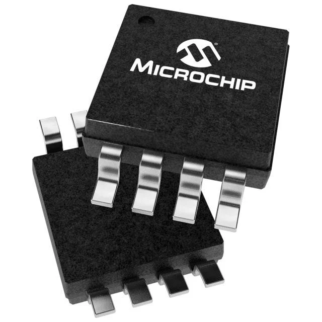
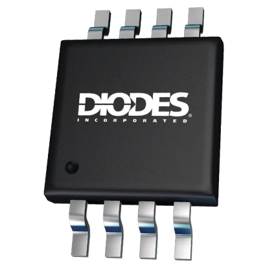
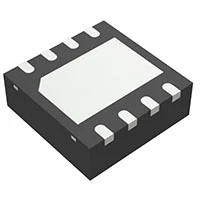
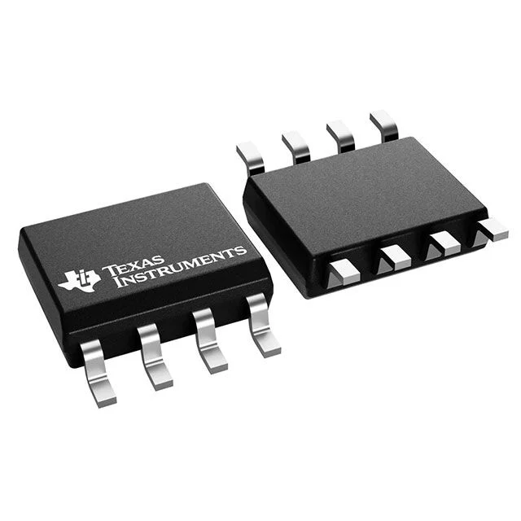
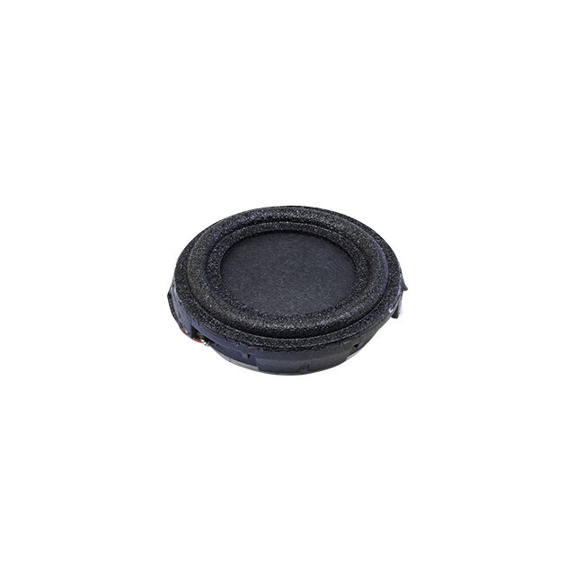
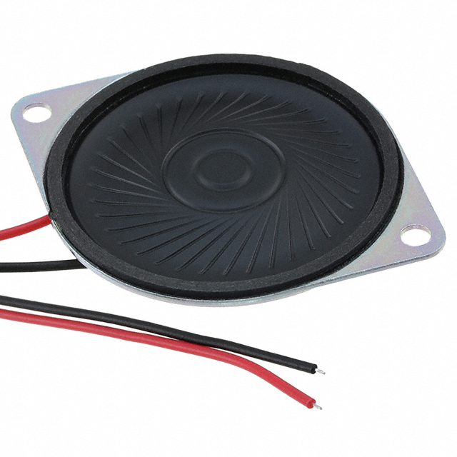
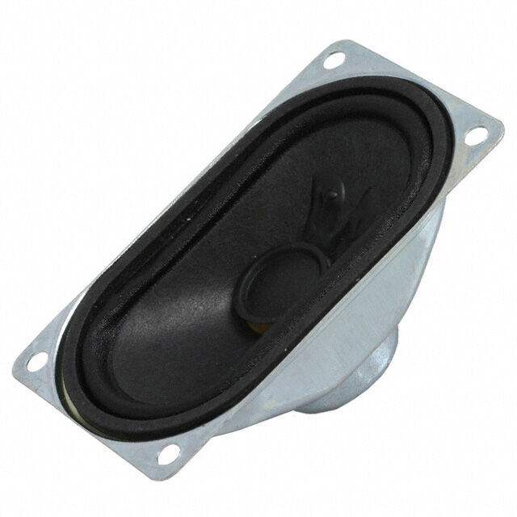

*Table 1: DAC component selection*

**Digital-to-Analog Converter (DAC) — Individual Subsystem**

| **Solution** | **Pros** | **Cons** |
|---|---|---|
|  **Option 1.** PIC18F57Q43 Internal 8-bit DAC $0 additional cost [PIC18F57Q43 Datasheet](https://www.microchip.com/en-us/product/PIC18F57Q43) | * No additional IC required * No additional PCB space required * No additional cost * No SPI communication required * 8-bit output is sufficient for basic tones and speech | * Limited to 256 output levels * Lower audio resolution than external DAC options * Uses an internal PIC peripheral |
|  **Option 2.** Microchip MCP4911-E/MS 10-bit SPI DAC $1.83/each [DigiKey Product Page](https://www.digikey.com/en/products/detail/microchip-technology/MCP4911-E-MS/2332825) | * 1024 output levels * Four times as many output levels as an 8-bit DAC * 2.7–5.5 V supply is compatible with the 5 V system * Simple SPI interface * Buffered voltage output * Good balance between resolution and cost | * Requires an additional IC * Requires additional PCB space * Requires SPI connections to the PIC * Requires an external voltage reference |
|  **Option 3.** Microchip MCP4921-E/SN 12-bit SPI DAC $2.62/each [DigiKey Product Page](https://www.digikey.com/en/products/detail/microchip-technology/MCP4921-E-SN/716196) | * 4096 output levels * Highest resolution of the three options * 2.7–5.5 V supply is compatible with the 5 V system * Simple SPI interface * SOIC package is relatively easy to solder | * Highest cost of the three options * Requires an additional IC and PCB space * Requires SPI connections to the PIC * 12-bit resolution may be unnecessary for speech, tones, and alerts * Requires an external voltage reference |

**Choice:** Option 2: Microchip MCP4911-E/MS 10-bit DAC

**Rationale:** The MCP4911 was selected because its 10-bit resolution provides 1024 discrete output levels, compared with only 256 levels from the PIC's internal 8-bit DAC. This provides improved resolution for recorded speech and audio while maintaining a simple SPI interface and compatibility with the board's 5 V power system. The MCP4921 provides greater 12-bit resolution, but this additional resolution is not necessary for the intended speech, tone, and alert playback application. The MCP4911 therefore provides a balance between audio resolution, cost, and PCB design complexity.

 
 

*Table 2: Audio amplifier component selection*

**Audio Power Amplifier — Individual Subsystem**

| **Solution** | **Pros** | **Cons** |
|---|---|---|
|  **Option 1.** Diodes Incorporated PAM8302A Class-D Mono Audio Amplifier ~$0.66/each [PAM8302A Product Information](https://www.diodes.com/part/view/PAM8302A) | * Class-D design provides high efficiency * Designed to drive low-impedance speakers * Approximately 2 W output into 4 Ω at 5 V with low distortion * 2–5.5 V supply range is compatible with the 5 V system * BTL output does not require a large speaker output coupling capacitor * Small component count | * Surface-mount package is more difficult to solder than through-hole components * Class-D switching makes PCB layout more important * Differential speaker output means neither speaker terminal can be connected to ground |
|  **Option 2.** Texas Instruments TPA2005D1DRBR Class-D Mono Audio Amplifier $1.08/each [DigiKey Product Page](https://www.digikey.com/en/products/detail/texas-instruments/TPA2005D1DRBR/565590) | * High-efficiency Class-D amplifier * 2.5–5.5 V supply is compatible with the 5 V system * Differential input * Includes thermal and short-circuit protection * Low power consumption | * More expensive than the PAM8302A * Lower useful output capability for this application * Small exposed-pad package is difficult to hand solder * PCB layout is more difficult due to the package and Class-D switching |
|  **Option 3.** Texas Instruments LM4871M/NOPB Class-AB Mono Audio Amplifier $1.92/each [DigiKey Product Page](https://www.digikey.com/en/products/detail/texas-instruments/LM4871M-NOPB/364185) | * 2–5.5 V supply is compatible with the 5 V system * SOIC-8 package is easier to solder * Simple analog amplifier architecture * Includes shutdown and thermal protection * Capable of driving low-impedance speakers | * Class-AB design is less efficient than Class-D alternatives * Greater power loss occurs as heat * Highest cost of the three options * Lower efficiency is undesirable when the board is powered from another board's VBUS |

**Choice:** Option 1: Diodes Incorporated PAM8302A

**Rationale:** The PAM8302A was selected because its Class-D architecture provides high efficiency while operating directly from the 5 V supply. It can provide approximately 2 W to a 4 Ω speaker, closely matching the requirements of the selected speaker. Compared with the LM4871, the PAM8302A wastes less power as heat, which is important because the speaker board receives power through the primary board's VBUS connection. It also provides a better combination of output capability, cost, and efficiency than the TPA2005D1.

 
 

*Table 3: Speaker component selection*

**Speaker — Individual Subsystem**

| **Solution** | **Pros** | **Cons** |
|---|---|---|
|  **Option 1.** Same Sky CMS-1852-24SP 4 Ω, 2 W Speaker $3.52/each [DigiKey Product Page](https://www.digikey.com/en/products/detail/same-sky-formerly-cui-devices/CMS-1852-24SP/21284683) | * Very compact 18 mm diameter * 4 Ω impedance is compatible with the selected amplifier * 2 W power rating closely matches amplifier output * 300 Hz–20 kHz specified frequency range * Lowest-cost speaker option | * Small diaphragm limits acoustic output and low-frequency performance * Lower specified sound pressure level than larger options * May provide lower-volume speech than larger speakers |
|  **Option 2.** Same Sky CMS-40504N-L152 4 Ω, 2 W Speaker $6.23/each [DigiKey Product Page](https://www.digikey.com/en/products/detail/same-sky-formerly-cui-devices/CMS-40504N-L152/6137739) | * 4 Ω impedance closely matches the PAM8302A * 2 W rated power closely matches amplifier output * Larger 40 mm diaphragm than Option 1 * Only 5 mm thick * 400 Hz–7 kHz frequency range is appropriate for speech and alerts * Good balance between physical size and audio output | * Larger diameter than Option 1 * More expensive than the smaller speaker * 7 kHz upper frequency limit reduces high-frequency reproduction compared with wider-band options |
|  **Option 3.** PUI Audio AS07104PO-R 4 Ω, 3 W Speaker $7.42/each [DigiKey Product Page](https://www.digikey.com/en/products/detail/pui-audio-inc/AS07104PO-R/2763867) | * 100 Hz–20 kHz specified frequency range * Better potential low-frequency reproduction * 3 W rated and 5 W maximum power handling * 4 Ω impedance is compatible with the amplifier * Largest speaker may provide stronger acoustic output | * Significantly larger at approximately 71 x 41 x 25 mm * Most expensive speaker option * PAM8302A cannot utilize the speaker's full power capability * Large size makes enclosure integration more difficult |

**Choice:** Option 2: Same Sky CMS-40504N-L152

**Rationale:** The CMS-40504N-L152 was selected because its 4 Ω impedance and 2 W continuous power rating closely match the output capabilities of the selected PAM8302A amplifier. Its 40 mm diameter provides a larger radiating surface than the 18 mm alternative while remaining only 5 mm thick. Its 400 Hz to 7 kHz frequency range should be adequate for intelligible speech, alerts, and generated tones. The larger PUI Audio speaker provides greater frequency range and power handling, but the additional size and power capability are unnecessary for the available amplifier output.