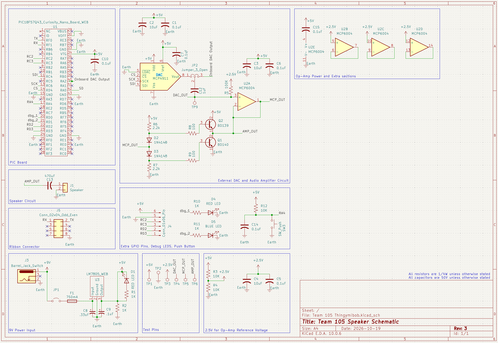

## Overview
The speaker subsystem is designed to provide audio output for the RadioLink communication device through recorded speech, tones, and alerts. The PIC18F57Q43 communicates with an MCP4911 10-bit DAC to generate the analog audio signal, while the PIC's internal DAC is available as a backup through a physical jumper. The signal is biased around a 2.5 V reference and processed by an MCP6004 op-amp before being sent to a BD139/BD140 Class-AB transistor stage, which provides the current needed to drive the 4 Ω speaker. The board also uses its own 9 V input and LM7805 regulator to provide the required 5 V supply.

This design satisfies the need for reliable and understandable audio output while also making the subsystem easier to test and troubleshoot. UART allows communication with the main RadioLink control board, while the backup DAC provides redundancy if the external DAC or SPI communication has issues. Debug LEDs, a pushbutton, test points, and spare GPIO connections provide additional ways to verify the circuit during development. Together, these features allow the speaker board to reliably convert digital information from the main system into audible speech and alerts while remaining easy to integrate and debug.

**Figure ##:** Project Schematic

## Resources

The schematic as a PDF download is available [*here*](Team 105 Thingymibob.pdf), and the Zip folder of the project [*here*](Team 105 Thingymibob.zip).