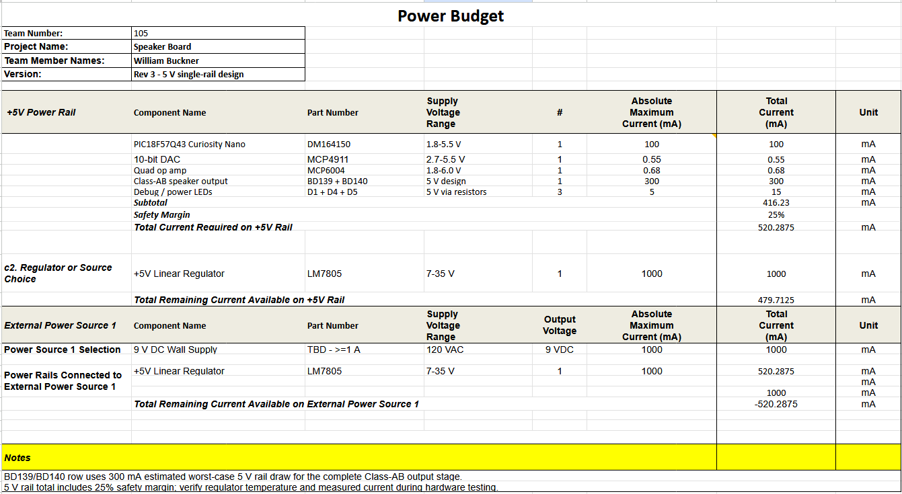

## Overview
A power budget was created to determine the current requirements of the speaker subsystem and verify that the selected power supply and voltage regulator can safely support the complete circuit. The board uses a single regulated 5 V power rail generated by an LM7805 linear voltage regulator from a 9 V external power supply. Current requirements were estimated for the PIC18F57Q43 Curiosity Nano, MCP4911 DAC, MCP6004 operational amplifier, BD139/BD140 Class-AB speaker output stage, and debugging and power LEDs.

The estimated maximum current consumption of these components is approximately 416 mA. A 25% safety margin was added to account for variations in component current consumption and operating conditions, resulting in a design requirement of approximately 520 mA on the 5 V rail. This value was then compared with the 1 A capability of the LM7805 and the selected 9 V external power supply to verify that sufficient current capacity is available for the subsystem.

{style width:"350" height:"300;"}

## Conclusions

The completed power budget indicates that the speaker subsystem can operate from a single regulated 5 V power rail. After applying the 25% safety margin, the calculated maximum current requirement is approximately 520 mA. The LM7805 is rated to supply up to 1 A, leaving approximately 480 mA of current capacity beyond the calculated design requirement.

A 9 V external power supply capable of supplying at least 1 A was therefore selected to provide sufficient power to the regulator and subsystem. The BD139/BD140 Class-AB speaker output stage represents the largest portion of the estimated current consumption and will be an important area to verify during physical testing. The power budget demonstrates that the selected supply and regulator provide adequate current capacity, although regulator temperature and actual current consumption should be measured during subsystem verification to confirm the design estimates.

## Resouces

The power budget as a PDF download is available [*here*](PowerBudget.pdf), and a Microsoft Excel Sheet [*here*](PowerBudget.xlsx).