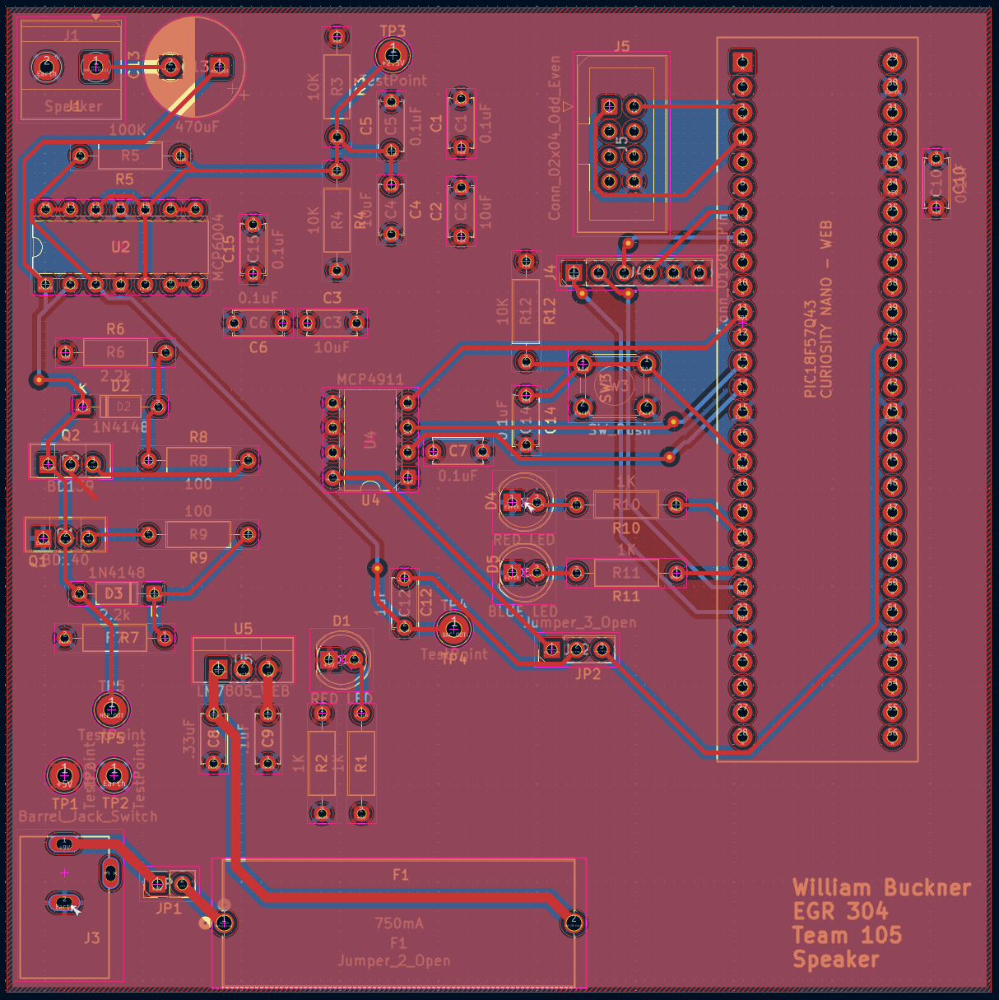

## Overview

This section documents the PCB design and layout for the speaker subsystem.

## PCB Layout

PCB layout for the speaker subsystem.

## Design Considerations

The PCB was designed to provide connections between the PIC18F57Q43 Curiosity Nano, DAC, amplifier circuitry, power supply, speaker output, and debugging components.

## Resources

The main project files are available [here](Team105Thingymibob.zip).
The gerber files are available [here](GerberFiles.zip).